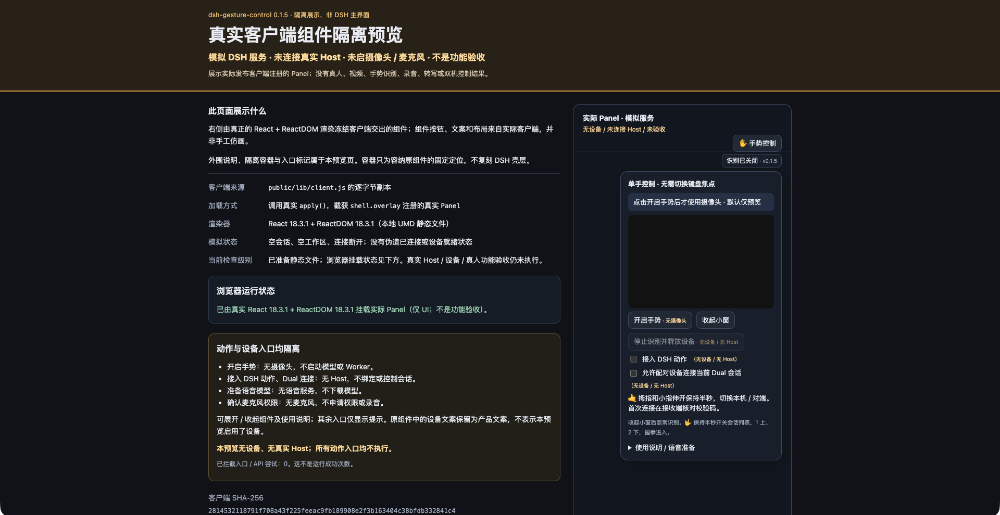

# 0.1.5 客户端组件隔离预览

截图时间：2026-11-16（America/Los_Angeles）。这是独立预览页，不是 DSH 主界面截图。

## 画面来源

- 使用发布包 `lib/client.js` 的逐字节副本，SHA-256：`2814532118791f708a43f225feeac9fb189908e2f3b163404c38bfdb332841c4`。
- 执行真实模块 factory 和 `apply()`，从 `shell.overlay` 注册取得实际闭包 Panel，由真实 React / ReactDOM 渲染。没有重新手绘产品面板。
- 使用本地化的 React、ReactDOM npm 18.3.1 UMD。ReactDOM 的实际 runtime marker 为 `18.3.1-next-f1338f8080-20240426`。
- 模拟的仅是空会话、空工作区、断开的 connection 及最小服务注册。画面中没有伪造摄像头帧、识别结果、转写内容或远端执行结果。
- 截图从预览浏览器窗口裁出页面内容，去除了浏览器标签栏及桌面叠加物；保留了完整的隔离说明与实际面板。没有修改面板像素来制造功能结果。

## 已检查和未检查

预览脚手架的 8 项静态 / 注册检查通过；父发布流程也在现有浏览器中观察到真实 React 挂载了实际 Panel。此结果仅涉及组件展示。

设备、Worker、录音、网络及 Host 动作入口在该预览页中均已隔离。摄像头识别、系统权限、语音转写、真实 DSH 集成和物理双机交互没有由该预览验收。发布包的 7 项分发检查是另一组检查，同样不替代这些功能验收。

预览脚手架只用于本次截图，没有写入 0.1.5 TGZ，也没有改变发布包运行逻辑。真实使用仍须满足项目说明中的 Windows Desktop 0.12.1 媒体权限补丁和 Harness 0.2.1-rc.2 前提。
